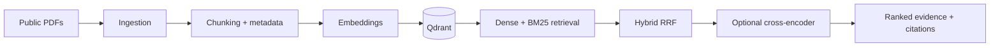

# Enterprise Multi-Document RAG Agent

[](https://github.com/MayankYadav-ds/enterprise-rag-agent/actions/workflows/ci.yml)
[](https://www.python.org/downloads/release/python-3110/)
[](LICENSE)

A retrieval foundation for an AI research assistant, with ranked document evidence and page-level citations.

> **Project status:** Ingestion, chunking, Qdrant indexing, dense/BM25/hybrid retrieval, optional cross-encoder reranking, and retrieval evaluation are implemented. Answer generation, the HTTP API, and an end-to-end demo remain planned.

## The problem

Long reports and technical manuals are difficult to search reliably. This project will ingest selected public documents, retrieve the most relevant evidence with both lexical and semantic search, and generate answers only when that evidence is strong enough. Weak retrieval should result in a transparent "I don't have enough evidence" response rather than a confident guess.

## Capabilities

- Parse PDFs while preserving page, heading, table, and source metadata.
- Compare fixed-size, recursive, and structure-aware chunking strategies.
- Index chunks into Qdrant with diff-based sync and payload patching.
- Search with dense vectors, pure-Python BM25, or hybrid reciprocal-rank fusion.
- Optionally rerank candidates with a lazily loaded cross-encoder.
- Return source/page citations and evaluate Recall@K, Precision@K, and MRR.

## Architecture



## Tech stack

| Concern | Choice | Why |
| --- | --- | --- |
| Runtime | Python 3.11 | Broad ML and backend support |
| Vector database | Qdrant | Self-hostable filtering and vector search |
| Embeddings | sentence-transformers | Local-capable, well-tested models |
| Quality | pytest, Ruff, pre-commit, GitHub Actions | Fast repeatable checks |

## Quick start

For the current foundation, create a Python 3.11 virtual environment and run the quality checks:

```bash
python -m pip install -e ".[dev]"
pre-commit install
ruff check .
pytest
```

The tokenizer path (`src/rag_agent/utils/lazy_tokenizer.py`, used by the
token-limit measurements in [`docs/TOKEN_LIMIT_REPORT.md`](docs/TOKEN_LIMIT_REPORT.md))
needs the model's WordPiece tokenizer but not the embedding model, so it pulls
in a smaller extra that does not require torch:

```bash
python -m pip install -e ".[tokenizer]"
```

`[embeddings]` adds `sentence-transformers` (and torch) on top of `[tokenizer]`,
so the full indexing pipeline needs `.[embeddings]`.

Use `.env.example` as a configuration reference. Export settings into the process environment; these CLIs do not automatically load `.env`. Never commit API keys. Install `.[embeddings]` for dense/hybrid search or reranking. Initial model use may download weights; with cached models, set `HF_HUB_OFFLINE=1` and `TRANSFORMERS_OFFLINE=1` to prohibit downloads.

## Indexing PDFs

Indexing runs the ingest → chunk → embed → Qdrant pipeline in one command:

```bash
python scripts/index_documents.py --input data/raw --strategy recursive
```

Re-running the command is idempotent: chunks whose IDs already exist are skipped,
and points removed from the document are deleted, so a re-index only ever
upserts what changed. Chunks that already exist but whose payload changed — a
renamed source file, a different model name, or refreshed page/heading/quality
metadata — are patched in place, so a renamed source file is reflected without
re-embedding the vector.

### Docker (recommended)

`docker-compose.yml` runs Qdrant locally on port 6333. The indexing container
must run on the same compose network so it can reach Qdrant by service name —
`host.docker.internal` does not work here. Start Qdrant, then run indexing with
the compose network attached:

```bash
docker compose up -d          # start Qdrant

docker run --rm \
    --network enterprise-rag-agent_default \
    --env QDRANT_URL=http://qdrant:6333 \
    --volume "$(pwd):/rag_agent" \
    --workdir /rag_agent \
    python:3.11 \
    sh -c 'python -m pip install -e ".[embeddings]" \
        && python scripts/index_documents.py \
            --input data/raw --strategy recursive --recreate \
            --qdrant-url http://qdrant:6333'
```

The repo is mounted at `/rag_agent`, so the indexer reads `data/raw` and writes
`data/processed` on the host. `Qdrant` is reachable as `http://qdrant:6333`
because both containers share the `enterprise-rag-agent_default` network.

The full run (compose up, wait for Qdrant, recreate, idempotent re-index, and smoke queries) is scripted in `scripts/index_in_docker.ps1` — run it from any folder, including the parent of the repo.

## Search

Three retrieval strategies are implemented and share one CLI:
`scripts/search.py` accepts `--strategy dense|bm25|hybrid` (dense is the
default). Each strategy implements the same `Retriever` protocol, so the
answer generator and citation layer are retriever-agnostic.

Dense-vector retrieval embeds a query with the same embedder that indexed the
collection, asks Qdrant for the nearest neighbours, and prints one line per hit
— rank, score, the citation (`[<file>, p. 22, <section_heading>]`) and a
120-character snippet:

```bash
python scripts/search.py "What risks did the company identify?" --top-k 5
```

Optional filters: `--doc-id` (one document), `--chunk-type` (`text` or
`table`), `--min-score` (drop hits below a score), `--collection`, and
`--qdrant-url`. The bge model needs torch, which Windows Application Control
blocks on this machine, so dense and hybrid search run inside the indexing
container via `scripts/run_in_docker.ps1`:

```bash
.\scripts\run_in_docker.ps1 -Command "python scripts/search.py 'What risks?' --top-k 5"
```

BM25 search does not need the embedder for scoring — it builds the
BM25 index from the collection's payload dictionary — so it works on machines
that block torch. Hybrid combines BM25 with dense retrieval and requires torch:

```bash
python scripts/search.py "What risks did the company identify?" --strategy bm25 --top-k 5
python scripts/search.py "What risks did the company identify?" --strategy hybrid --top-k 5
```

Score semantics differ by strategy: dense scores are cosine similarity in
`[-1, 1]`; BM25 scores are unbounded BM25 contributions; hybrid scores are sums
of RRF contributions in `(0, 2)`. See [docs/EVALUATION.md](docs/EVALUATION.md).

### Cross-encoder reranking

```bash
python scripts/search.py "What risks did the company identify?" \
    --strategy hybrid --rerank --rerank-candidates 20 --top-k 5
```

The default model is `cross-encoder/ms-marco-MiniLM-L-6-v2` on CPU.
`--rerank-model` overrides `RERANKER_MODEL`, then the built-in default.
Reranking loads the model only when candidates exist, scores query/chunk pairs
in batches, preserves citation metadata, and rejects non-finite scores.
Use `RERANKER_DEVICE` and `RERANKER_BATCH_SIZE` to configure execution.
Cross-encoder scores are not calibrated probabilities or dense similarities.

### torch and Windows Application Control

The embedding model (BAAI/bge-small-en-v1.5) is backed by PyTorch, which this
repository loads via `sentence-transformers`. On some Windows machines an
Application Control policy blocks torch's shared libraries
(`WinError 4551` on `torch/lib/c10.dll`), and the model cannot be loaded. When
that happens the indexer and `scripts/smoke_queries.py` exit with a clear error
before touching the store.

Indexing can then run unchanged inside a Linux container: build the image with
the `[embeddings]` extra installed and torch working, point it at the same
Qdrant server, and re-run the commands above. The token-limit measurements in
[`docs/TOKEN_LIMIT_REPORT.md`](docs/TOKEN_LIMIT_REPORT.md) were collected with the
model's WordPiece tokenizer alone, which needs no torch.

## Ingest PDFs

Put legally usable PDFs under `data/raw/` (this directory is deliberately Git-ignored), then run:

```bash
python scripts/ingest.py --input data/raw --output data/processed
```

The command logs processed, skipped, failed, page, table, low-text-quality-page, and warning totals. It writes one JSON file per source hash in `data/processed/`; repeating the command skips files with an existing hash, so re-ingestion is idempotent. Each retained page uses the physical PDF page index starting at 1, which is the citation convention for later phases. See [data/README.md](data/README.md) for public sources and download instructions.

The ingestion parser uses PyMuPDF for positioned text and typography, and pdfplumber for ruled tables. It normalises whitespace and hyphenated line breaks, records headings, removes frequent edge headers/footers and standalone printed page numbers, and logs image-only pages instead of silently pretending OCR succeeded. It also scores page text from 0 to 1; scores below 0.900 warn about extraction artifacts such as `(cid:N)` tokens, literal U+FFFD, or control characters.

## API example

The `/ingest`, `/query`, and `/health` endpoints arrive in Phase 7. The final query flow will look like:

```bash
curl -N -X POST http://localhost:8000/query \
  -H "content-type: application/json" \
  -d '{"question":"What risks did the company identify?"}'
```

## Evaluation

The evaluation framework supports all three retrieval strategies and optional
reranking, with Recall@1/3/5/10, Precision@1/3/5/10, MRR, per-query rankings,
and recorded strategy/model settings. See [docs/EVALUATION.md](docs/EVALUATION.md).

The preserved 20-query gold set (`b4b9bd873762`) has known relevance-label and
corpus-coverage limitations. Historical reports are retained for transparency,
not presented as a validated benchmark of the current implementation. In
particular, BM25's IDF formula was corrected after those runs; no new live
quality evaluation has been performed for this revision.

The historical controlled comparison used identical depth-20 hybrid candidate
pools and final top-k 10: baseline MRR was 0.314167 versus 0.291250 with reranking;
Recall@10 was 0.625 for both. This does not establish that reranking improves
retrieval. See [data/eval/README.md](data/eval/README.md) for artifact provenance
and limitations. Fake model scores are used only in tests.

## Design decisions and trade-offs

The project uses Qdrant for local vector storage and sentence-transformers for embeddings. Dense, BM25, hybrid retrieval, cross-encoder reranking, page-level citations, and retrieval evaluation are implemented; answer generation and the API remain planned — see [docs/DECISIONS.md](docs/DECISIONS.md) for decisions and trade-offs.

## Project structure

```text
src/rag_agent/        Application package
  ingestion/          PDF parsing and normalisation
  chunking/           Chunking strategies
  embeddings/         Embedding and vector indexing
  retrieval/          Dense, BM25, hybrid, reranking, citations
  generation/         (stub — Phase 6)
  api/                (stub — Phase 7)
  evaluation/         Gold set, retrieval metrics, runner
tests/                 Unit and integration tests
data/                  Legally usable source documents and provenance
docs/                  Architecture, decisions, and evaluation records
scripts/               Repeatable developer commands
.github/workflows/    Continuous integration
```

## Limitations and future work

The current repository does not include OCR: image-only/scanned pages are warned about and skipped. PDF font encodings can also produce unreadable glyph mappings, and complex unruled financial tables can split into fragments. Phase 2 validation notes document both observations and the next steps; future work includes OCR, table-region merging, and page-render-based quality checks.

## Roadmap (planned, not implemented)

Retrieval through Phase 5.4 and retrieval metrics are implemented. Remaining work:

- **Phase 6 — Answer generation.** `src/rag_agent/generation/`: grounded answers
  streamed over Server-Sent Events with document and page citations.
- **Phase 7 — HTTP API.** `src/rag_agent/api/`: `/ingest`, `/query`, and
  `/health` endpoints (FastAPI, not yet a dependency).
- **Generation evaluation.** RAGAS metrics and a larger human-adjudicated
  retrieval benchmark remain planned. Existing retrieval metrics are implemented.
- **Phase 9 — Dockerised demo.** A one-command demo (`docker compose up`)
  would need a `Dockerfile` that does not exist yet; today Qdrant is run via
  `docker-compose.yml` and indexing via the manual `docker run` commands in
  [Docker (recommended)](#docker-recommended).
- **Phase 10 — Hardening.** Authentication, rate limiting, and production
  deployment configuration.

## Contributing

Contributions are welcome once the initial pipeline is in place. Read [CONTRIBUTING.md](CONTRIBUTING.md) for local setup and quality expectations.

## License

Released under the [MIT License](LICENSE).
