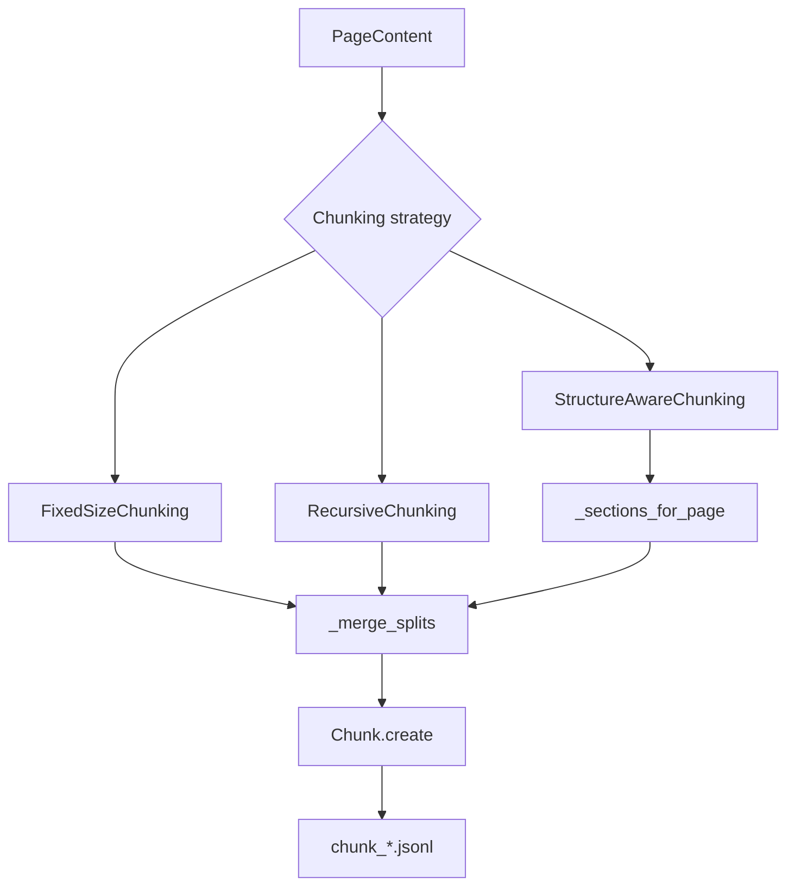

# Architecture

## Overview

The agent ingests public PDFs, chunks them, indexes the chunks, and retrieves
evidence with page-level citations. Answer generation is planned.

## Ingestion

`src/rag_agent/ingestion/` parses each PDF into a hash-named JSON record:

- PyMuPDF extracts positioned text spans with font size and bold flags.
- pdfplumber extracts ruled tables as Markdown.
- `clean_text` normalises Unicode, repairs hyphenated line breaks, and drops
  private-use area glyphs (`Co`) and format characters (`Cf`).
- Repeated edge headers/footers and standalone printed page numbers are removed.
- Each page is scored 0-1; pages below 0.900 warn about extraction artifacts.

## Chunking

`src/rag_agent/chunking/` implements three strategies behind a common
interface. The chunking step is the focus of this phase.

### Fixed-size

Sentences are packed into chunks of approximately `chunk_size` tokens with
`chunk_overlap` tokens of carry-over. Simplest and fastest; boundaries fall at
arbitrary sentence positions.

### Recursive

Splits by paragraph, then sentence, then word, then merges with overlap. The
paragraph/sentence boundaries are the same as fixed-size, but oversized
paragraphs are split by sentence boundary before falling back to a
character-boundary cut, so chunks end at a natural sentence end more often.

### Structure-aware

Splits each page by detected headings first, then applies recursive chunking
within each section. A heading names the section that **follows** it; a
trailing heading with no body on its page is dropped rather than glued onto
the previous section's body. SEC "Item NN." headings are recognised by pattern
in both the ingestion detector and the chunker's fallback.

### Shared rules

- Tables are atomic units, split by rows with header repetition when they
  exceed chunk size.
- Pages below the text-quality threshold are excluded by default.
- No empty or near-empty chunks are produced (minimum size enforced).
- Chunk IDs are deterministic: `chunk_<doc_id>_<8-hex-position>_<16-hex-sha256>`.

## Indexing (embeddings + Qdrant)

`scripts/index_documents.py` runs ingest → chunk → embed → Qdrant in one pass.
Each chunk is embedded with the BAAI/bge-small-en-v1.5 model and stored as a
point in a Qdrant collection.

- Vectors are L2-normalised so cosine similarity equals the dot product in Qdrant.
- Point IDs are deterministic UUID5s derived from the chunk ID, so re-runs never
  duplicate points and a diff-based sync only upserts what changed.
- Each point carries a payload with `chunk_id`, `doc_id`, `source_file`,
  `chunk_type`, `page_start`, `page_end`, `section_heading`, `text_quality`,
  `token_count`, `text` and `embedding_model`, so citations can be answered from
  Qdrant without re-hydrating chunks. `source_file` is stored as the bare file
  name, so a renamed source file is reflected without re-hydrating the chunk.
- The diff-based sync returns `{"upserted", "deleted", "skipped",
  "payload_updated"}`. Chunks that already exist but whose payload changed
  (a renamed source file, a different model name, or refreshed page/heading/
  quality/text metadata) are patched in place with `batch_update_points` and
  `SetPayloadOperation` — the vector is never touched, so the cosine similarity
  is unchanged and nothing is re-embedded.
- The model silently truncates text beyond 512 WordPiece tokens, so chunk size
  was lowered from 512/50 to 400/39. See [`docs/TOKEN_LIMIT_REPORT.md`](TOKEN_LIMIT_REPORT.md).

## Retrieval

`src/rag_agent/retrieval/` implements dense, BM25, hybrid RRF, and optional cross-encoder reranking.
`DenseRetriever` embeds the query with the same embedder that indexed the
collection, asks Qdrant for the nearest neighbours, and returns `RetrievedChunk`
hits ranked 1..N best first. Every retriever implements the same `Retriever`
protocol, so the search CLI and the citation layer are retriever-agnostic.

A hit carries the fields a citation needs — source file, page range, section
heading — plus the fields the answer generator needs: text, score, rank and
which retriever produced it. Citations are formatted once, in
`rag_agent.retrieval.citation`, as `[<file>, p. 22, <section_heading>]` (or
`pp. 22-23` for a range), using the bare file name stored in the payload so a
renamed source file is reflected without re-hydrating the chunk.

## Hybrid retrieval and reranking

BM25 uses lowercase word tokens and log-smoothed inverse document frequency.
Hybrid retrieval requests the same depth from dense and BM25, merges by chunk
ID, and sums `k/(k+rank)` contributions (default k=60). This is standard RRF
scaled by the constant k, preserving its ranking. A top-k request controls both
component depth and final fused count.

The cross-encoder wrapper requests a candidate pool from its base retriever,
lazily scores query/chunk pairs, then returns final top-k hits with the original
citation metadata. Model scores must be finite. Dense/hybrid require an
embedding model; BM25 alone reads payloads without loading one.

## Evaluation and remaining scope

`src/rag_agent/evaluation/` implements gold-file versioning, Recall@K,
Precision@K, MRR, per-query rankings, and JSON/text reports. Recorded settings
identify the strategy and reranker. Candidate depth must be controlled when
comparing hybrid with reranked hybrid. Historical reports and label limitations
are documented in [EVALUATION.md](EVALUATION.md).

`src/rag_agent/generation/` and `src/rag_agent/api/` remain stubs. Grounded answer
generation, an HTTP API, generation metrics, a complete demo, and production
hardening are planned, not delivered by the retrieval pipeline.
